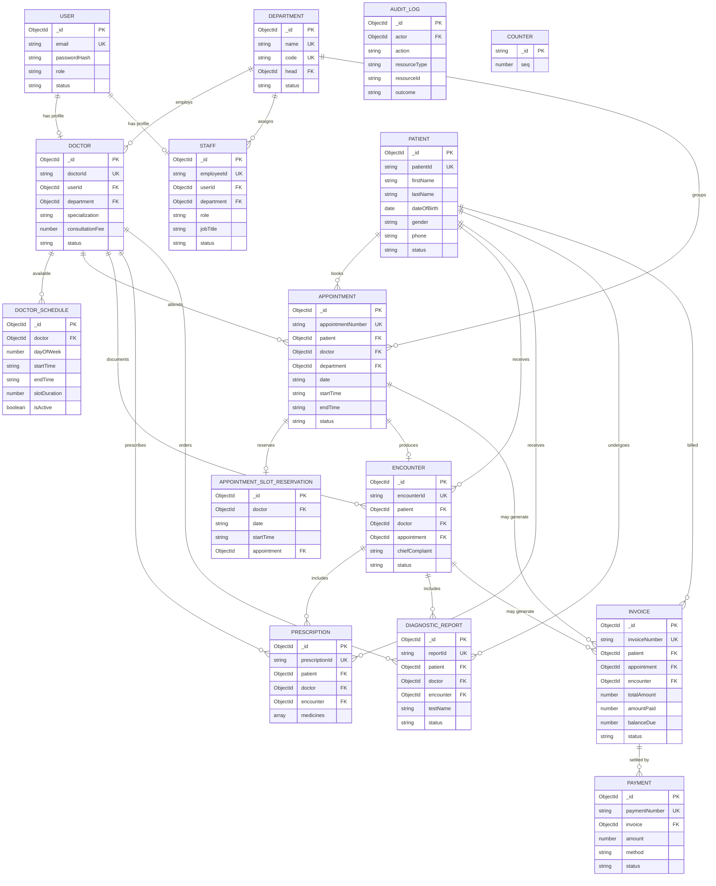

# Entity Relationship Diagram

`AuditLog` and `Counter` are operational collections and are not connected by foreign keys. Audit entries reference actors and resources by loose IDs so they remain readable after business records change.
