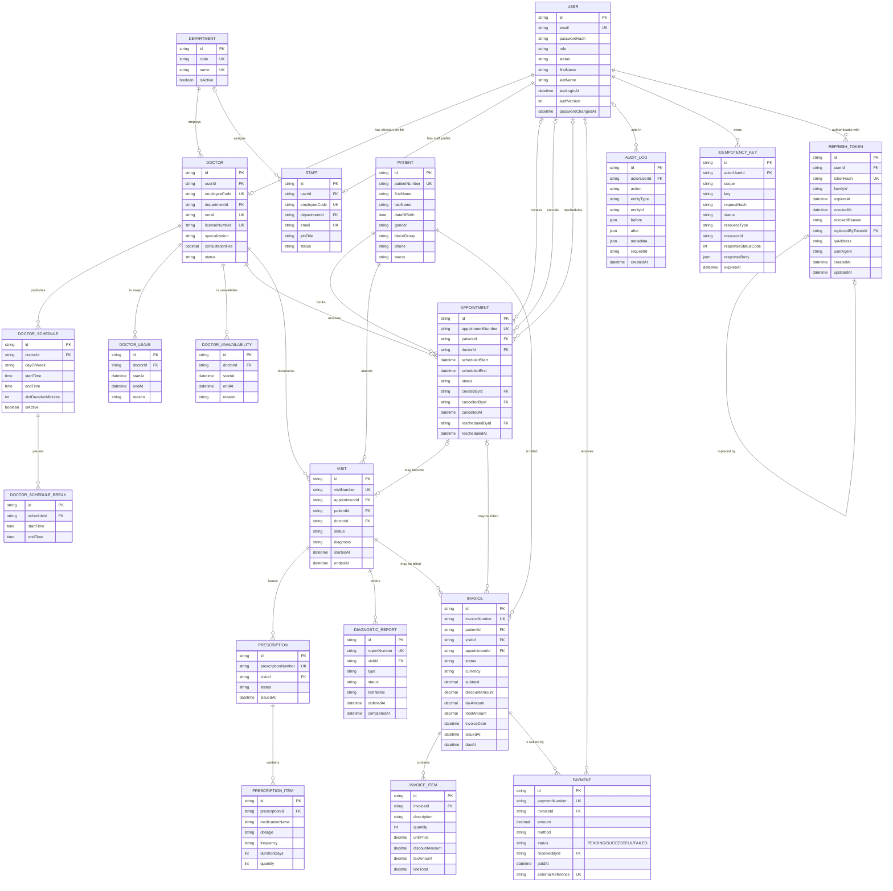

# Entity-Relationship Diagram

The diagram uses Prisma model names. PostgreSQL stores these as quoted PascalCase table
names such as `"Appointment"`. Enum values and every scalar field are documented in the
[data dictionary](data-dictionary.md).

## Relationship summary

| Child / foreign key               | Parent           | Cardinality                    | On delete  |
| --------------------------------- | ---------------- | ------------------------------ | ---------- |
| `Doctor.userId`                   | `User`           | Exactly one user per doctor    | `Restrict` |
| `Staff.userId`                    | `User`           | Exactly one user per staff row | `Restrict` |
| `Doctor.departmentId`             | `Department`     | Exactly one department         | `Restrict` |
| `Staff.departmentId`              | `Department`     | Zero or one department         | `SetNull`  |
| `DoctorSchedule.doctorId`         | `Doctor`         | Exactly one doctor             | `Cascade`  |
| `DoctorScheduleBreak.scheduleId`  | `DoctorSchedule` | Exactly one schedule           | `Cascade`  |
| `DoctorLeave.doctorId`            | `Doctor`         | Exactly one doctor             | `Cascade`  |
| `DoctorUnavailability.doctorId`   | `Doctor`         | Exactly one doctor             | `Cascade`  |
| `Appointment.patientId`           | `Patient`        | Exactly one patient            | `Restrict` |
| `Appointment.doctorId`            | `Doctor`         | Exactly one doctor             | `Restrict` |
| `Appointment.createdById`         | `User`           | Zero or one creating user      | `SetNull`  |
| `Appointment.cancelledById`       | `User`           | Zero or one cancelling user    | `SetNull`  |
| `Appointment.rescheduledById`     | `User`           | Zero or one rescheduling user  | `SetNull`  |
| `Visit.appointmentId`             | `Appointment`    | Zero or one appointment        | `SetNull`  |
| `Visit.patientId`                 | `Patient`        | Exactly one patient            | `Restrict` |
| `Visit.doctorId`                  | `Doctor`         | Exactly one doctor             | `Restrict` |
| `Prescription.visitId`            | `Visit`          | Exactly one visit              | `Restrict` |
| `PrescriptionItem.prescriptionId` | `Prescription`   | Exactly one prescription       | `Cascade`  |
| `DiagnosticReport.visitId`        | `Visit`          | Exactly one visit              | `Restrict` |
| `Invoice.patientId`               | `Patient`        | Exactly one patient, required  | `Restrict` |
| `Invoice.visitId`                 | `Visit`          | Zero or one visit              | `Restrict` |
| `Invoice.appointmentId`           | `Appointment`    | Zero or one appointment        | `Restrict` |
| `InvoiceItem.invoiceId`           | `Invoice`        | Exactly one invoice            | `Cascade`  |
| `Payment.invoiceId`               | `Invoice`        | Exactly one invoice            | `Restrict` |
| `Payment.receivedById`            | `User`           | Zero or one receiving user     | `SetNull`  |
| `AuditLog.actorUserId`            | `User`           | Zero or one acting user        | `SetNull`  |
| `IdempotencyKey.actorUserId`      | `User`           | Exactly one acting user        | `Cascade`  |
| `RefreshToken.userId`             | `User`           | Exactly one token owner        | `Cascade`  |
| `RefreshToken.replacedByTokenId`  | `RefreshToken`   | Zero or one replacement token  | `SetNull`  |

`AuditLog.entityType` and `AuditLog.entityId` are a deliberate polymorphic reference.
They are not a foreign key because audit records may outlive the entity they describe.

## Aggregate boundaries

- **Master data:** `User`, `Patient`, `Department`, `Doctor`, and `Staff`.
- **Scheduling:** `DoctorSchedule`, `DoctorScheduleBreak`, `DoctorLeave`,
  `DoctorUnavailability`, and `Appointment`.
- **Clinical encounter:** `Visit`, `Prescription`, `PrescriptionItem`, and
  `DiagnosticReport`.
- **Revenue cycle:** `Invoice`, `InvoiceItem`, and `Payment`.
- **Cross-cutting control:** `AuditLog`, `IdempotencyKey`, and `RefreshToken`.

Clinical and billing records are always reached through `Visit`. This keeps a single
patient/doctor encounter as the source of truth while preserving historical records when a
patient, doctor, or user is deactivated. Hard deletion is restricted for clinical and
financial parents.
