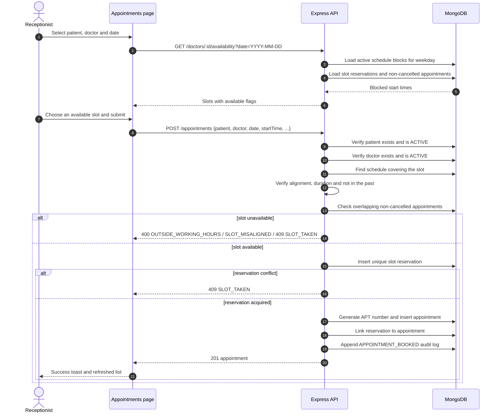

# Appointment Booking Sequence

## Failure handling

- If appointment creation fails after the reservation is acquired, the reservation is deleted so the slot is immediately reusable.
- Rescheduling reserves the new slot first, saves the appointment, then releases the old reservation. If saving fails, the new reservation is released.
- Cancellation deletes all reservations for the appointment.
- A completed appointment keeps its reservation so the historical slot remains unavailable for rebooking.
