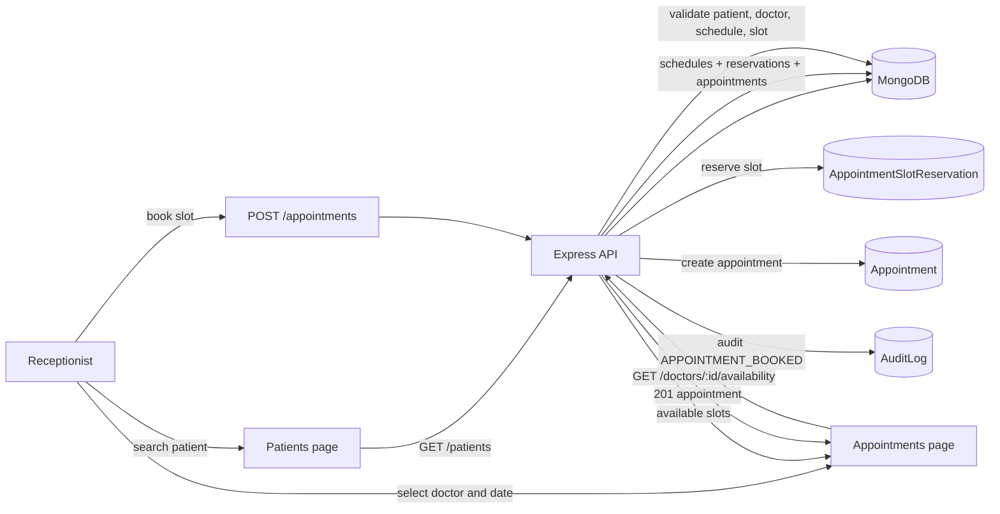
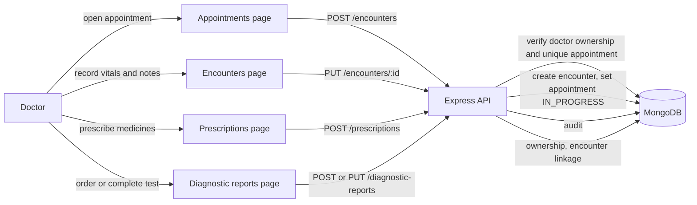
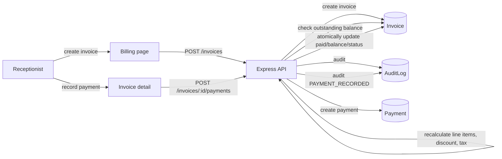
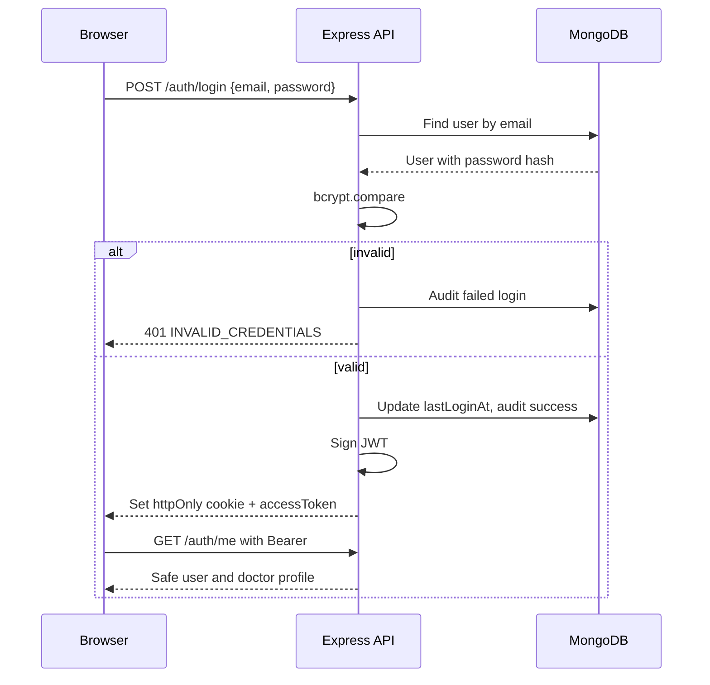

# Data Flow Diagram

## Patient booking flow



## Clinical flow



## Billing flow



## Dashboard and reporting flow

```mermaid
flowchart LR
    U[User] -->|open dashboard| UI[Dashboard page]
    UI -->|GET /dashboard/{admin|receptionist|doctor}| API[Express API]
    API -->|aggregate patients, appointments, revenue, activity| DB[(MongoDB)]
    API -->|summary cards and recent lists| UI

    A[Admin] -->|filter reports| RP[Reports page]
    RP -->|GET /reports/*| API
    API -->|aggregate by date, doctor, department| DB
    API -->|chart-ready data| RP
```

## Login flow


