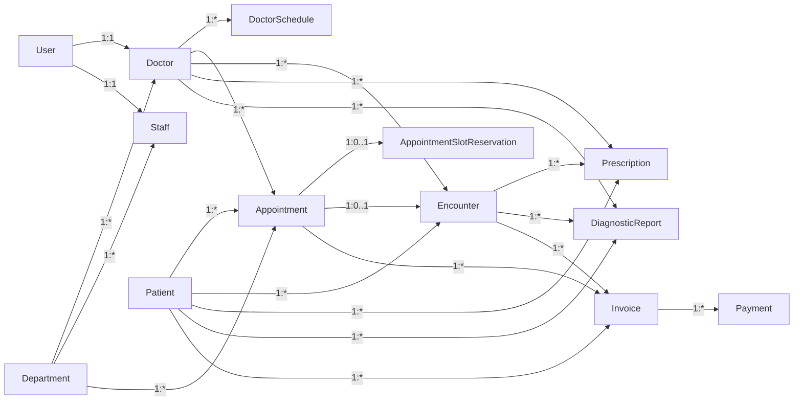

# Database ER Diagram

The authoritative field-level model and constraints are in [the data dictionary](../database/data-dictionary.md) and [relationships](../database/relationships-and-constraints.md). A full Mermaid `erDiagram` is available in [database/er-diagram.md](../database/er-diagram.md).
