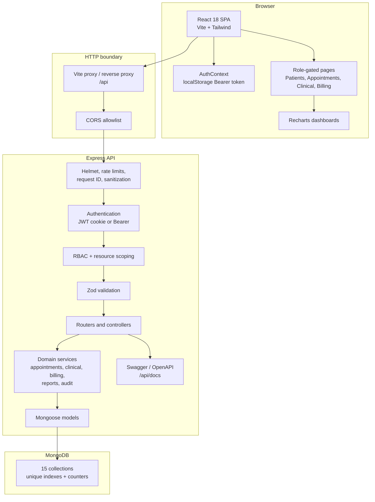

# System Architecture Diagram

## Trust boundaries

- The browser is untrusted. Every authorization and business rule is rechecked by the API.
- The frontend role guards only improve navigation; they do not replace server authorization.
- MongoDB is the source of truth for uniqueness, slots, balances and audit records.
- Swagger is enabled by the API and documents the same route contracts used by the frontend.
